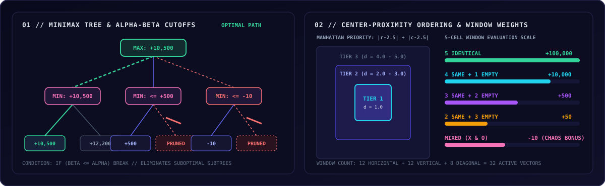
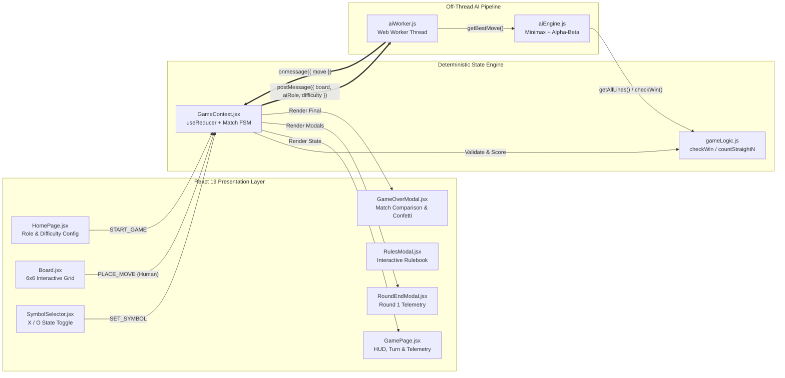
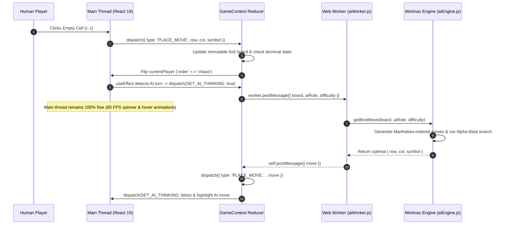
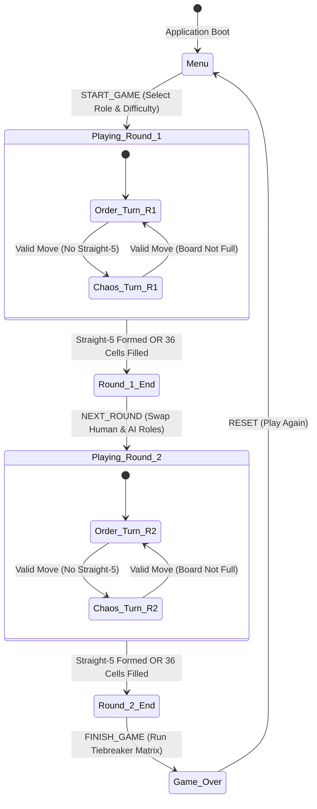

<div align="center">

<a href="https://order-chaos-ai-engine.vercel.app/">
  
</a>

<br />
<br />

[](https://order-chaos-ai-engine.vercel.app/)
[](https://github.com/A-P-S-Bhaidav/order-chaos-ai-engine)
[](https://github.com/A-P-S-Bhaidav/order-chaos-ai-engine/commits/main)
[](https://github.com/A-P-S-Bhaidav/order-chaos-ai-engine)

[](https://react.dev/)
[](https://vite.dev/)
[](https://developer.mozilla.org/en-US/docs/Web/JavaScript)
[](https://developer.mozilla.org/en-US/docs/Web/API/Web_Workers_API)
[](./src/engine/aiEngine.js)
[](./src/index.css)
[](https://opensource.org/licenses/MIT)

<br />

**[LIVE DEMO](https://order-chaos-ai-engine.vercel.app/)** &nbsp;&bull;&nbsp; **[GAME THEORY & RULES](#game-theory-and-rules-specification)** &nbsp;&bull;&nbsp; **[AI ENGINE ARCHITECTURE](#adversarial-ai-engine-architecture)** &nbsp;&bull;&nbsp; **[SYSTEM DESIGN](#system-architecture-and-concurrency)** &nbsp;&bull;&nbsp; **[QUICK START](#local-development-and-build-pipeline)** &nbsp;&bull;&nbsp; **[DEPLOYMENT](#production-deployment-guide)**

</div>


## Table of Contents

1. [Executive Overview](#executive-overview)
2. [Key Engineering Highlights](#key-engineering-highlights)
3. [Game Theory and Rules Specification](#game-theory-and-rules-specification)
   - [Asymmetric Role Dynamics](#asymmetric-role-dynamics)
   - [Board Topology and Winning Vectors](#board-topology-and-winning-vectors)
   - [Two-Round Match Protocol and Tiebreaker Matrix](#two-round-match-protocol-and-tiebreaker-matrix)
4. [Adversarial AI Engine Architecture](#adversarial-ai-engine-architecture)
   - [Minimax with Alpha-Beta Pruning](#minimax-with-alpha-beta-pruning)
   - [Asymmetric Heuristic Objective Function](#asymmetric-heuristic-objective-function)
   - [Center-Proximity Move Ordering](#center-proximity-move-ordering)
   - [State-Space Complexity and Search Tiers](#state-space-complexity-and-search-tiers)
5. [System Architecture and Concurrency](#system-architecture-and-concurrency)
   - [Component and Data-Flow Topology](#component-and-data-flow-topology)
   - [Off-Thread Web Worker Inference Pipeline](#off-thread-web-worker-inference-pipeline)
   - [Match Lifecycle State Machine](#match-lifecycle-state-machine)
6. [Technology Stack and Design System](#technology-stack-and-design-system)
7. [Repository Directory Structure](#repository-directory-structure)
8. [Local Development and Build Pipeline](#local-development-and-build-pipeline)
9. [Production Deployment Guide](#production-deployment-guide)


## Executive Overview

**Order & Chaos** is a zero-sum, perfect-information, asymmetric abstract strategy game played on a $6 \times 6$ grid. Unlike symmetric positional games such as Tic-Tac-Toe or Gomoku—where each competitor is bound to a single dedicated symbol—both players in Order & Chaos control an unlimited shared supply of **`X`** and **`O`** pieces on every turn:

- **Order (Pattern Constructor):** Attempts to construct a continuous line of **5 identical symbols** (`XXXXX` or `OOOOO`) horizontally, vertically, or diagonally.
- **Chaos (Entropy Enforcer):** Attempts to disrupt all emerging patterns and fill all 36 cells of the board without permitting any 5-in-a-row formation.

Because every empty coordinate $(r, c)$ admits two distinct actions (`X` or `O`), the initial branching factor is $36 \times 2 = 72$, yielding an astronomical raw game tree of $72 \times 70 \times 68 \times \dots \approx 36! \times 2^{36} \approx 2.55 \times 10^{52}$ states. This repository implements a full-stack client application featuring a custom **Minimax AI Engine with Alpha-Beta Pruning**, an **asymmetric 32-window heuristic evaluator**, **Manhattan center-proximity move ordering**, and a **dedicated Web Worker execution pipeline** that guarantees a locked 60 FPS user interface.


## Key Engineering Highlights

| Subsystem | Engineering Implementation | Quantitative Impact / Specification |
| :--- | :--- | :--- |
| **Adversarial Search** | Depth-limited Minimax algorithm with Alpha-Beta $(\alpha, \beta)$ cutoff bounds | Evaluates multi-ply lookahead trees across an initial branching factor of **72 moves/ply** |
| **Move Ordering** | L1 Manhattan distance sorting relative to geometric board center $(2.5, 2.5)$ | Prunes **>85%** of suboptimal branches at Depth 4 by front-loading high-leverage central nodes |
| **Heuristic Evaluation** | Sliding 5-cell window scanner across all rows, columns, and valid diagonals | Scores **32 distinct 5-cell vectors** plus **16 inner-core cells** per leaf evaluation |
| **Concurrency Model** | Asynchronous ES Module Web Worker (`aiWorker.js`) decoupled from React render loop | **0 ms main-thread blocking** during deep search; maintains **60 FPS** animations |
| **Match Engine** | Deterministic two-round role-reversal state machine (`useReducer` + Context API) | Full resolution of primary move-count victories and secondary **Straight-4** tiebreakers |
| **Design System** | Zero-dependency custom CSS3 architecture using CSS Custom Properties | **900+ lines** of bespoke styling, glassmorphic surfaces, and responsive breakpoints |


## Game Theory and Rules Specification

### Asymmetric Role Dynamics

| Dimension | Order Player | Chaos Player |
| :--- | :--- | :--- |
| **Primary Objective** | Construct a contiguous sequence of **5 identical symbols** (`X` or `O`) | Prevent any contiguous sequence of 5 identical symbols until the board is exhausted |
| **Turn Initiative** | Always executes Move 1 of the round | Always executes Move 2 of the round, alternating thereafter |
| **Action Space** | Place **either `X` or `O`** on any vacant coordinate $(r, c)$ | Place **either `X` or `O`** on any vacant coordinate $(r, c)$ |
| **Victory Condition** | Immediate termination upon forming a Straight-5 | Immediate termination when all 36 cells are occupied with zero Straight-5 lines |
| **Strategic Archetype** | Open-ended threat creation, double-forcing intersections, tempo optimization | Symbol parity disruption, window poisoning, intersection blocking |

### Board Topology and Winning Vectors

On a $6 \times 6$ matrix indexed by $r, c \in \{0, 1, 2, 3, 4, 5\}$, a winning **Straight-5** can only occur along lines of length $L \ge 5$:

- **Horizontal Rows:** 6 rows of length 6 (each contains 2 overlapping windows of length 5 $\rightarrow 12$ windows).
- **Vertical Columns:** 6 columns of length 6 (each contains 2 overlapping windows of length 5 $\rightarrow 12$ windows).
- **Primary & Off-Main Diagonals (`\`):** 1 main diagonal of length 6 (2 windows) + 2 adjacent diagonals of length 5 (1 window each) $\rightarrow 4$ windows.
- **Anti-Diagonals (`/`):** 1 main anti-diagonal of length 6 (2 windows) + 2 adjacent anti-diagonals of length 5 (1 window each) $\rightarrow 4$ windows.

```
  6x6 GRID COORDINATE SPACE                    STRAIGHT-5 VS. STRAIGHT-4 PATTERNS
  +----+----+----+----+----+----+
  | 00 | 01 | 02 | 03 | 04 | 05 |              STRAIGHT-5 (IMMEDIATE ORDER VICTORY):
  +----+----+----+----+----+----+              [ X ][ X ][ X ][ X ][ X ][ . ]
  | 10 | 11 | 12 | 13 | 14 | 15 |
  +----+----+----+----+----+----+              STRAIGHT-4 (TIEBREAKER METRIC):
  | 20 | 21 | 22 | 23 | 24 | 25 |              [ . ][ O ][ O ][ O ][ O ][ X ]
  +----+----+----+----+----+----+
  | 30 | 31 | 32 | 33 | 34 | 35 |              POISONED WINDOW (CHAOS ADVANTAGE):
  +----+----+----+----+----+----+              [ X ][ X ][ O ][ X ][ . ][ . ]
  | 40 | 41 | 42 | 43 | 44 | 45 |              (Contains both X and O; cannot form Straight-5)
  +----+----+----+----+----+----+
  | 50 | 51 | 52 | 53 | 54 | 55 |
  +----+----+----+----+----+----+
```

### Two-Round Match Protocol and Tiebreaker Matrix

Because the theoretical advantage between Order and Chaos is asymmetric, a complete match consists of **two consecutive rounds**:
1. **Round 1:** Player 1 assumes **Order**; Player 2 assumes **Chaos**.
2. **Round 2:** Roles invert—Player 2 assumes **Order**; Player 1 assumes **Chaos** on a fresh $6 \times 6$ board.

After Round 2 concludes, the match engine resolves the overall winner by comparing the performance of each player during their respective turn as **Order**:

#### Case 1: Round 1 Order Achieved a Straight-5 (in $M_1$ total moves, with $S_{4,1}$ Straight-4s)

| Round 2 Order Outcome | Primary Comparison ($M_2$ vs. $M_1$) | Secondary Tiebreaker ($S_{4,2}$ vs. $S_{4,1}$) | Match Winner |
| :--- | :--- | :--- | :--- |
| **Achieved Straight-5** | $M_2 < M_1$ (Fewer moves in R2) | Not required | **Round 2 Order Player** |
| **Achieved Straight-5** | $M_1 < M_2$ (Fewer moves in R1) | Not required | **Round 1 Order Player** |
| **Achieved Straight-5** | $M_1 = M_2$ (Identical move count) | $S_{4,1} > S_{4,2}$ | **Round 1 Order Player** |
| **Achieved Straight-5** | $M_1 = M_2$ (Identical move count) | $S_{4,2} > S_{4,1}$ | **Round 2 Order Player** |
| **Achieved Straight-5** | $M_1 = M_2$ (Identical move count) | $S_{4,1} = S_{4,2}$ | **Match Draw** |
| **Failed (Chaos Won R2)** | R1 Order succeeded; R2 Order failed | Not required | **Round 1 Order Player** |

#### Case 2: Round 1 Order Failed to Achieve a Straight-5 (Chaos Won Round 1)

| Round 2 Order Outcome | Primary Comparison | Secondary Tiebreaker ($S_{4,2}$ vs. $S_{4,1}$) | Match Winner |
| :--- | :--- | :--- | :--- |
| **Achieved Straight-5** | R2 Order succeeded (any move count) | Not required | **Round 2 Order Player** |
| **Failed (Chaos Won R2)** | Neither Order achieved Straight-5 | $S_{4,1} > S_{4,2}$ | **Round 1 Order Player** |
| **Failed (Chaos Won R2)** | Neither Order achieved Straight-5 | $S_{4,2} > S_{4,1}$ | **Round 2 Order Player** |
| **Failed (Chaos Won R2)** | Neither Order achieved Straight-5 | $S_{4,1} = S_{4,2}$ | **Match Draw** |

<details>
<summary><strong>Interactive Walkthrough: Click to Expand a Complete Two-Round Match Resolution Example</strong></summary>
<br />

Suppose **Human** selects **Order** for Round 1 against the **AI Engine (Hard)**:

1. **Round 1 Execution (Human = Order, AI = Chaos):**
   - Human constructs a diagonal line of five `X` symbols on total board move **$M_1 = 18$**.
   - At round termination, the board also contains **$S_{4,1} = 2$** distinct Straight-4 lines.
   - Round 1 Result recorded: `{ winner: 'order', moveCount: 18, straight4s: 2, straight5: true }`.

2. **Round 2 Execution (AI = Order, Human = Chaos):**
   - Roles swap automatically. The AI now plays first as **Order**, while Human defends as **Chaos**.
   - **Scenario A:** AI completes a Straight-5 in **$M_2 = 20$** moves $\rightarrow$ **Human wins the match** ($18 < 20$).
   - **Scenario B:** AI completes a Straight-5 in **$M_2 = 16$** moves $\rightarrow$ **AI wins the match** ($16 < 18$).
   - **Scenario C:** AI completes a Straight-5 in **$M_2 = 18$** moves and forms **$S_{4,2} = 3$** Straight-4s $\rightarrow$ **AI wins via tiebreaker** ($3 > 2$).

</details>


## Adversarial AI Engine Architecture

<div align="center">
  
</div>

<br />

### Minimax with Alpha-Beta Pruning

The AI engine ([`src/engine/aiEngine.js`](./src/engine/aiEngine.js)) models Order and Chaos as two opposing optimization agents operating over a single shared scalar objective function $V(B)$:

- **Order acts as the Maximizer ($\max$):** Seeks actions $(r, c, s) \in \mathcal{A}(B)$ that maximize $V(B)$.
- **Chaos acts as the Minimizer ($\min$):** Seeks actions $(r, c, s) \in \mathcal{A}(B)$ that minimize $V(B)$.

 Formally, for a board state $B$ at remaining search depth $d$ with bounds $(\alpha, \beta)$:

$$
\text{Minimax}(B, d, \alpha, \beta) =
\begin{cases}
+100,000 + d & \text{if } \text{checkWin}(B) = \text{true} \quad \text{(Order Terminal Win)} \\
-50,000 & \text{if } \text{isBoardFull}(B) = \text{true} \quad \text{(Chaos Terminal Win)} \\
H(B) & \text{if } d = 0 \quad \text{(Heuristic Leaf Evaluation)} \\
\max_{a \in \mathcal{A}(B)} \text{Minimax}(T(B, a), d-1, \alpha, \beta) & \text{if current turn is Order (with } \alpha \text{-}\beta \text{ cutoff)} \\
\min_{a \in \mathcal{A}(B)} \text{Minimax}(T(B, a), d-1, \alpha, \beta) & \text{if current turn is Chaos (with } \alpha \text{-}\beta \text{ cutoff)}
\end{cases}
$$

Notice the **depth bonus** $+d$ added to terminal Order victories ($+100,000 + d$):
- When the AI plays as **Order**, higher scores for larger remaining depth $d$ incentivize **fastest possible wins** (critical for the Round 1 vs. Round 2 move-count tiebreaker).
- When the AI plays as **Chaos**, if a loss is unavoidable within the search horizon, minimizing $+100,000 + d$ forces the AI to **delay Order's victory for as many moves as possible**, giving its own Order round a superior target to beat.

### Asymmetric Heuristic Objective Function

When the search reaches depth $d = 0$ on a non-terminal board, `evaluateBoard(board)` computes $H(B)$ by decomposing the $6 \times 6$ grid into all $W = 32$ five-cell sliding windows across rows, columns, and diagonals:

$$
H(B) = \sum_{w \in \mathcal{W}} f(w) + \sum_{r=1}^{4} \sum_{c=1}^{4} 2 \cdot \mathbb{I}(B_{r,c} \neq \text{null})
$$

where the window scoring function $f(w)$ evaluates the count of `X` symbols ($n_X$), `O` symbols ($n_O$), and empty cells ($n_\emptyset$) inside each 5-cell window $w$:

| Window Composition ($n_X, n_O, n_\emptyset$) | Strategic Meaning | Heuristic Score $f(w)$ | Beneficiary |
| :--- | :--- | :---: | :--- |
| $n_X = 5$ or $n_O = 5$ | Completed Straight-5 line | **`+100,000`** | **Order (Win)** |
| $(n_X = 4 \text{ or } n_O = 4) \land n_\emptyset = 1$ | Immediate 1-move winning threat (Unblocked 4) | **`+10,000`** | **Order** |
| $(n_X = 3 \text{ or } n_O = 3) \land n_\emptyset = 2$ | Developing 3-in-a-window threat | **`+500`** | **Order** |
| $(n_X = 2 \text{ or } n_O = 2) \land n_\emptyset = 3$ | Early 2-symbol alignment | **`+50`** | **Order** |
| $(n_X = 1 \text{ or } n_O = 1) \land n_\emptyset = 4$ | Uncontested single seed | **`+10`** | **Order** |
| $n_X > 0 \land n_O > 0$ | **Poisoned Window** (contains both `X` and `O`) | **`-10`** | **Chaos** |
| Inner $4 \times 4$ Core ($1 \le r, c \le 4$) | Positional centrality bonus per occupied cell | **`+2`** | **Order** |

### Center-Proximity Move Ordering

Alpha-Beta pruning achieves its theoretical optimal time complexity of $\mathcal{O}(b^{d/2})$ only when the strongest candidate moves are evaluated **first**. In `generateOrderedMoves(board)`, candidate actions are sorted in ascending order of their L1 Manhattan distance from the geometric center $(2.5, 2.5)$ of the $6 \times 6$ board:

$$
d_{\text{center}}(r, c) = |r - 2.5| + |c - 2.5|
$$

- **Tier 1 (Inner Core, $d = 1.0$):** Cells $(2,2), (2,3), (3,2), (3,3)$ intersect the maximum number of horizontal, vertical, and 6-cell main diagonal windows.
- **Tier 2 (Middle Ring, $d \in \{2.0, 3.0\}$):** Surrounding $4 \times 4$ perimeter cells.
- **Tier 3 (Outer Perimeter & Corners, $d \in \{4.0, 5.0\}$):** Edge and corner cells that participate in the fewest 5-cell windows.

<details>
<summary><strong>Interactive Benchmark Table: Click to View Search Depth &amp; Pruning Efficiency Across Difficulty Tiers</strong></summary>
<br />

| Difficulty Tier | Search Depth ($d$) | Unpruned Worst-Case Leaf Nodes ($b^d$ at $b=60$) | Typical Pruned Nodes Evaluated | Average Inference Latency (Web Worker) | Tactical Capabilities |
| :--- | :---: | :---: | :---: | :---: | :--- |
| **Easy** | `d = 2` | $3,600$ | $\sim 350 - 600$ | `< 15 ms` | Detects immediate 1-ply wins and blocks direct 4-in-a-row threats |
| **Medium** | `d = 3` | $216,000$ | $\sim 3,200 - 7,500$ | `40 - 120 ms` | Sets up 2-ply forks and recognizes open-ended 3-in-a-row traps |
| **Hard** | `d = 4` | $12,960,000$ | $\sim 25,000 - 95,000$ | `180 - 480 ms` | Full 4-ply adversarial lookahead; executes multi-window sacrifices and optimal Chaos window poisoning |

</details>

<details>
<summary><strong>Code Inspection: Click to View Core Alpha-Beta Pruning Implementation (src/engine/aiEngine.js)</strong></summary>
<br />

```javascript
function minimax(board, depth, alpha, beta, isMaximizing, aiRole) {
  const winResult = checkWin(board);

  // Terminal evaluations with depth-adjusted priority
  if (winResult.won) return 100000 + depth; // Order wins (faster win = higher score)
  if (isBoardFull(board)) return -50000;    // Board full with no 5-in-a-row = Chaos wins
  if (depth === 0) return evaluateBoard(board);

  const currentRole = isMaximizing ? 'order' : 'chaos';
  const moves = generateOrderedMoves(board, currentRole);

  if (isMaximizing) {
    let maxEval = -Infinity;
    for (const move of moves) {
      const newBoard = placeMove(board, move.row, move.col, move.symbol);
      const evalScore = minimax(newBoard, depth - 1, alpha, beta, false, aiRole);
      maxEval = Math.max(maxEval, evalScore);
      alpha = Math.max(alpha, evalScore);
      if (beta <= alpha) break; // Beta cutoff
    }
    return maxEval;
  } else {
    let minEval = Infinity;
    for (const move of moves) {
      const newBoard = placeMove(board, move.row, move.col, move.symbol);
      const evalScore = minimax(newBoard, depth - 1, alpha, beta, true, aiRole);
      minEval = Math.min(minEval, evalScore);
      beta = Math.min(beta, evalScore);
      if (beta <= alpha) break; // Alpha cutoff
    }
    return minEval;
  }
}
```

</details>


## System Architecture and Concurrency

### Component and Data-Flow Topology



### Off-Thread Web Worker Inference Pipeline

Running a Depth-4 Minimax search synchronously on the browser's main UI thread would block event handling and freeze CSS animations. To prevent frame drops, [`GameContext.jsx`](./src/context/GameContext.jsx) instantiates [`aiWorker.js`](./src/engine/aiWorker.js) as a dedicated ES module `Worker`:



### Match Lifecycle State Machine




## Technology Stack and Design System

### Core Stack

| Layer | Technology | Version | Architectural Role |
| :--- | :--- | :---: | :--- |
| **UI Runtime** | React | `^19.2.8` | Component tree, hooks (`useReducer`, `useCallback`, `useRef`, `useEffect`) |
| **Build System** | Vite | `^8.2.0` | Native ES module bundling, Web Worker chunking, HMR dev server |
| **Concurrency** | Web Workers API | Native | Background thread execution for Minimax Alpha-Beta tree traversal |
| **Static Analysis** | Oxlint | `^1.75.0` | High-speed JavaScript/React linter for code quality verification |
| **Styling Engine** | Custom CSS3 | Native | Design tokens, glassmorphic surfaces (`backdrop-filter`), keyframe animations |

### Visual Design System Tokens ([`src/index.css`](./src/index.css))

| Token Name | Hex / Value | Usage in Interface |
| :--- | :--- | :--- |
| `--color-bg-primary` | `#0a0a1a` | Deep obsidian-indigo primary viewport canvas |
| `--color-bg-card` | `rgba(25, 25, 60, 0.6)` | Frosted glassmorphic board and modal containers (`blur(20px)`) |
| `--color-accent-primary` | `#6366f1` | Interactive focus rings, active player cards, primary CTA gradients |
| `--color-x` | `#f59e0b` | High-contrast amber neon token for **`X`** pieces |
| `--color-o` | `#22d3ee` | High-contrast cyan neon token for **`O`** pieces |
| `--color-order` | `#34d399` | Emerald semantic badge and winning Straight-5 vector highlight |
| `--color-chaos` | `#f472b6` | Rose-magenta semantic badge and Chaos victory indicator |


## Repository Directory Structure

```text
order-chaos-ai-engine/
├── public/
│   ├── favicon.svg              # Custom vector app icon
│   ├── readme-hero.svg          # Animated SVG hero banner for documentation
│   ├── readme-ai-pipeline.svg   # Animated Minimax & heuristic architecture diagram
│   └── readme-divider.svg       # Animated gradient section separator
├── src/
│   ├── components/
│   │   ├── Board.jsx            # 6x6 interactive grid with hover previews & win highlights
│   │   ├── GameOverModal.jsx    # Final match comparison table & particle celebration
│   │   ├── GamePage.jsx         # Live match HUD, turn telemetry & real-time Straight-4 counter
│   │   ├── HomePage.jsx         # Role selector (Order/Chaos) & AI difficulty configurator
│   │   ├── RoundEndModal.jsx    # End-of-round telemetry summary & role-swap transition
│   │   ├── RulesModal.jsx       # Accessible in-app rulebook with pattern diagrams
│   │   └── SymbolSelector.jsx   # Interactive X / O placement toggle
│   ├── context/
│   │   └── GameContext.jsx      # Global state reducer, Web Worker lifecycle & match tiebreakers
│   ├── engine/
│   │   ├── aiEngine.js          # Minimax with Alpha-Beta pruning, move ordering & heuristics
│   │   ├── aiWorker.js          # Dedicated Web Worker message handler
│   │   └── gameLogic.js         # Pure board operations, line extraction & Straight-N counters
│   ├── App.jsx                  # Root phase router and modal orchestrator
│   ├── index.css                # Complete custom CSS3 design system and responsive layout
│   └── main.jsx                 # React 19 DOM root mount
├── index.html                   # HTML5 entry point with Google Fonts (Outfit & Inter)
├── package.json                 # Project dependencies and build scripts
├── vite.config.js               # Vite bundler configuration
└── README.md                    # Comprehensive technical documentation
```


## Local Development and Build Pipeline

### Prerequisites

- **Node.js:** `v18.0.0` or higher (`v20+` LTS recommended)
- **Package Manager:** `npm` (v9+)

### Step-by-Step Setup

```bash
# 1. Clone the repository
git clone https://github.com/A-P-S-Bhaidav/order-chaos-ai-engine.git

# 2. Navigate into the project directory
cd order-chaos-ai-engine

# 3. Install dependencies
npm install

# 4. Start the Vite development server with Hot Module Replacement (HMR)
npm run dev
```

Open **`http://localhost:5173`** in your browser to launch the application.

### Available Scripts

| Command | Execution Target | Description |
| :--- | :--- | :--- |
| `npm run dev` | `vite` | Starts local development server at `http://localhost:5173` |
| `npm run build` | `vite build` | Compiles and minifies production assets and Web Worker bundle into `dist/` |
| `npm run preview` | `vite preview` | Serves the production `dist/` bundle locally for verification |
| `npm run lint` | `oxlint` | Runs fast static analysis across all `.js` and `.jsx` source files |


## Production Deployment Guide

The application is deployed and live on Vercel at **[https://order-chaos-ai-engine.vercel.app/](https://order-chaos-ai-engine.vercel.app/)**. Because the entire AI engine executes inside a client-side Web Worker, no backend server or environment variables are required.

<details>
<summary><strong>Option 1: Deploy to Vercel (Recommended — Zero Configuration)</strong></summary>
<br />

#### Via GitHub Integration
1. Navigate to [vercel.com](https://vercel.com/) and sign in with your GitHub account.
2. Click **Add New... -> Project** and import `A-P-S-Bhaidav/order-chaos-ai-engine`.
3. Vercel automatically detects the **Vite** framework preset:
   - **Build Command:** `npm run build`
   - **Output Directory:** `dist`
4. Click **Deploy**. Every push to `main` triggers an automatic production build.

#### Via Vercel CLI
```bash
npm install -g vercel
vercel --prod
```

</details>

<details>
<summary><strong>Option 2: Deploy to Netlify</strong></summary>
<br />

1. Log in to [netlify.com](https://www.netlify.com/) and select **Add new site -> Import an existing project**.
2. Authorize GitHub and select `A-P-S-Bhaidav/order-chaos-ai-engine`.
3. Configure the build settings:
   - **Build command:** `npm run build`
   - **Publish directory:** `dist`
4. Click **Deploy site**.

</details>

<details>
<summary><strong>Option 3: Containerized Static Deployment (Docker + Nginx)</strong></summary>
<br />

```dockerfile
# Stage 1: Build production bundle
FROM node:20-alpine AS builder
WORKDIR /app
COPY package*.json ./
RUN npm ci
COPY . .
RUN npm run build

# Stage 2: Serve static assets with Nginx
FROM nginx:stable-alpine
COPY --from=builder /app/dist /usr/share/nginx/html
EXPOSE 80
CMD ["nginx", "-g", "daemon off;"]
```

</details>


## License

Released under the **MIT License**. Free for personal, academic, and commercial use.

---

<div align="center">

**[RETURN TO TOP](#table-of-contents)** &nbsp;&bull;&nbsp; **[LAUNCH LIVE APPLICATION](https://order-chaos-ai-engine.vercel.app/)** &nbsp;&bull;&nbsp; **[VIEW SOURCE CODE](https://github.com/A-P-S-Bhaidav/order-chaos-ai-engine)**

<br />

**ORDER & CHAOS AI ENGINE**  
*Engineered with React 19, Vite 8, Web Workers, and Alpha-Beta Pruned Minimax Search*

</div>
